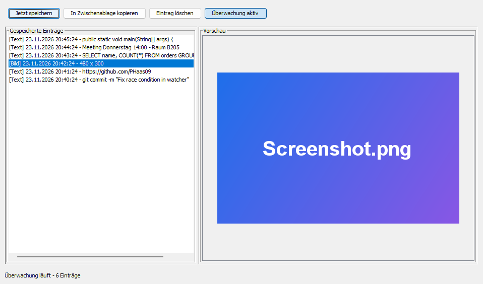

<div align="center">

# 📋 Clipboard History

**Never lose something you copied again.** A small desktop app that records everything you copy, text *and* images, and lets you put any old entry back on the clipboard with a double-click.

[](https://github.com/PHaas09/ClipboardHistory-Project/actions/workflows/build.yml)


[](https://github.com/PHaas09/ClipboardHistory-Project/releases/latest)



</div>

## Features

- **Watches the clipboard in the background** and checks for changes every 0.8 seconds.
- **Text and images:** images are stored as PNG and shown in a scaled preview.
- **Survives restarts:** the history is kept in `~/.clipboard-history-app/` and is loaded again on the next start.
- **Copy back** with a double-click or the *In Zwischenablage kopieren* button.
- **No duplicates:** each entry is hashed with SHA-256, so copying the same thing twice doesn't add a second entry.
- **Pause** the watcher at any time, save the current clipboard manually and delete single entries.
- The newest **200** entries are kept.
- A single Java file using only Swing, with no external libraries.

## Run it

**Download:** get `ClipboardHistory.jar` from the [latest release](https://github.com/PHaas09/ClipboardHistory-Project/releases/latest) and double-click it, or run:

```bash
java -jar ClipboardHistory.jar
```

**From source (JDK 17+):**

```bash
javac -d out src/ClipboardHistoryApp.java
java -cp out ClipboardHistoryApp
```

## How it works

A `ScheduledExecutorService` polls the system clipboard. Every new item is hashed and written to its own file (`.txt` or `.png`). The list of entries is saved to `history.ser`. All UI updates go through the Swing event thread.

> The UI is in German.
